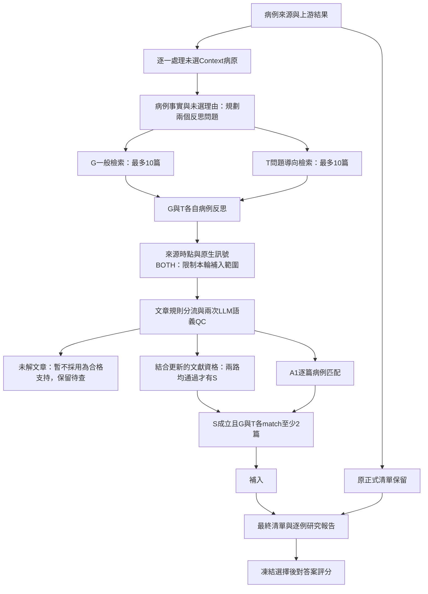

# 目前OBER工作流

這是現有模組依賴與條件式重播流程。最近QC實驗沒有重抽前段G/T病例反思與A1六個病例軸；它主要重做文章分類並重播下游，不是完整端到端重跑。

## 1. 輸入與分流

上游正式陽性包含Picked、Possible、Fallback-Possible，全部保留。只對Context候選考慮補入，不刪正式清單、不產生池外病原。每個病例—病原獨立綁定來源，保留採檢事件、背景、影像、候選檢測及原未選理由。缺資料不當作陰性。

## 2. 問題計畫與G/T檢索

先從致病／定植、檢體定位、宿主症候群、檢驗解讀四個大軸，提出兩個來源支持的問題。G使用病原與肺部感染的一般搜尋並包含限制性文獻；T依兩個問題搜尋，保留一般錨點及反證搜尋。每路最多10篇、去重，實際不一定滿10篇。G/T可重疊，不是20篇獨立支持。檢索材料主要是PubMed標題／摘要，凍結出版截止2026-10-31，並非已讀所有全文。

## 3. G/T病例反思

兩路病例、原理由與問題相同，主要差別是文章。每路需成立：候選檢出，肺部事件與定位支持或合理可能；具體病例—文章橋接；有來源的原理由修正；沒有決定性未解反證；有適用且用於修正理由的合格文獻。broad容許compatible病例橋接，且不自動攔下substantial_unresolved疑慮；不能把通過解讀成無反證。

## 4. 訊號與來源防護

原生BOTH是「上游每測試RPM與QC絕對軸」AND「上游rank_band為top_1／top_3相對軸」，不是G/T一致。未知不是陰性，但不能提供對應正向旗標。技術分支不算獨立臨床確認，不加總跨測試reads。已知混入晚期來源的候選暫緩補入；此防護不是宣稱全病歷已重新清理並重判。

## 5. 文章分類與QC

非常明確的同句人類—病原—肺部致病陳述由正向規則處理，其餘送語義QC；沒關鍵詞不直接判不支持，沒摘要不靠標題補造。QC只看文章／病原，沒有病人或醫院答案；固定兩次同模型，不重抽到一致。

文章分別標記人類疾病歸因、直接肺部歸因、病原→疾病→肺部表現鏈、非因果情境、其他繼發病原、研究設計與解析度。成熟臨床文獻可由直接病因或完整疾病相關肺部支持鏈通過文獻閘門；單個case_only可以供A1匹配，但不單獨通過成熟文獻閘門。取得分類共識不等於正向支持；兩次可一致判定不合格。

未解QC保留來源／分歧，不自動第三次裁決，也沒有自動查全文→裁決→回填的完整閉環。其他已解文章仍可能讓候選通過，不因一篇QC就刪病人或否定感染。

## 6. A1病例匹配

兩個文章欄位：病原解析度、人類致病情境。六個病例軸：部位、症候群、檢體、宿主、臨床表現、時間。A1病例視圖不給mNGS強度、微生物檢測結果、上游選擇與醫院答案。文章QC統一前兩欄，原病例六軸固定。

strong_match需同病原、人類致病、部位與症候群完全匹配，額外四軸至少一軸match且沒有mismatch。硬條件成立但未達strong可成partial_match；部分額外軸不合仍可能是partial。其他為mismatch或insufficient，並有來源引用檢查。最終使用match=strong+partial，不是直接請模型決定是否補入。

## 7. S與k

S是G與T**都通過**整體反思條件，不是第三個模型，也不是兩路都否定就算一致通過。主設定還須兩路A1 match各≥2。同一路PMID不重複；兩路可共用同篇，不要求四篇互不重複文獻。不額外要求strong≥2，不使用舊match≥7規則，也不把早期C/Q/C3探索分支全疊入目前主設定。

## 8. 合併與評分

最終＝原正式清單∪補入。保留逐例研究選擇、文章判讀、來源與待查事項，凍結無答案選擇後才讀參考答案。聚合分數不能證明引用解讀正確，也不能取代醫學審查。簡易版／可追溯交付產生器是另一交付層，不冒稱這輪已全部重新執行。

本輪實際範圍：319個Context→44個原生BOTH→40個來源未暫緩→36個有可用摘要→5個固定非文獻臨床條件可通過的候選→3個補入。58個病原—文章配對中1個規則處理、57個每篇兩次QC；57個送審不等於57個最終未解。
